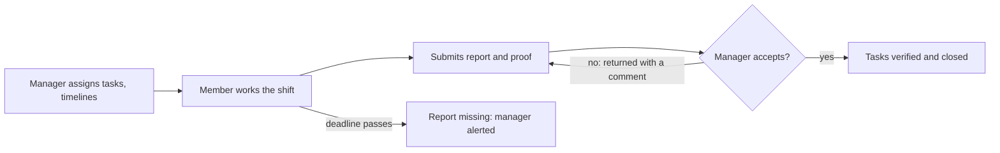

# AI Business OS — Software Requirements Specification

Last updated Oct 28, 2026 · @SRV

> **Main spec since 28 Oct 2026.** Sections 1 to 16 are the business analyst's text (owner: @SRV). Edit them only from the BA's new versions.
> Appendix A (at the end) is written by engineering: the build status of the app, mapping from the old OpsDesk SRS v1.2, and the Phase 1 front-end plan.
> The old spec is kept as [`SRS-v1.2-built.md`](SRS-v1.2-built.md). It is the record of what was built. IDs like `FR-TASK-14`, `FR-REP-12`, `OC-05` in code comments refer to it.
> The full comparison is in [`srs-diff-2026-10-28.md`](srs-diff-2026-10-28.md).

## 1. Introduction

This SRS defines what the AI Business OS must do, module by module, so each module can be designed, built, tested and sold one after another. It is a specification, not an implementation; no code is part of this document.

### 1.1 Purpose

- Give the engineering team a buildable, testable list of requirements for each module.
- Make the first client's needs explicit and traceable (section 15).
- Fix the build order so every later module reuses the shared platform foundation.

### 1.2 Scope

The product is a multi-tenant, modular SaaS platform for SMEs (5 to 250 employees) in Ireland first, then the UK and the EU. It covers tasks and projects, AI assistance, workflow automation, HR, CRM, project resourcing, operational finance, payroll integration and reporting. Out of scope for v1: a full accounting ledger, in-house statutory payroll calculation, and native iOS apps.

### 1.3 Audience

Product owner, solution architect, developers, QA, UI/UX designers, the security and data protection lead, and the first client's sponsor for sign-off of section 15.

### 1.4 Conventions

| Prefix | Meaning | Example |
| --- | --- | --- |
| FR-Mx-nn | Functional requirement of module x | FR-M1-07 |
| NFR-nn | Cross-cutting non-functional requirement | NFR-04 |
| CR-nn | First client requirement | CR-03 |
| AC-Mx-nn | Acceptance criterion of module x | AC-M1-02 |

Priority uses MoSCoW: **Must** (release blocker), **Should** (planned for the release), **Could** (if time allows), **Won't** (not this release).

### 1.5 References

- Product Vision, Strategy & Feature Blueprint (provided by SRV, 27 Oct 2026).
- First client core requirements (provided by SRV, 27 Oct 2026).
- Structure follows ISO/IEC/IEEE 29148 (successor to IEEE 830).
- GDPR (EU 2016/679), EU AI Act (EU 2024/1689), WCAG 2.2 AA.

## 2. Overall description

The platform is one modular monolith with a shared foundation; each module is a separately licensed product that switches on through plan entitlements, with no data migration when a customer adds a module.

### 2.1 Product perspective

- Web app (responsive, desktop first) plus an Android app for field and shift staff. iOS follows later.
- One PostgreSQL database with tenant isolation; modules own their own tables and talk through internal APIs and domain events.
- External integrations: Google Workspace and Microsoft 365 (calendar, mail, Drive), accounting tools, an Irish payroll provider, payment provider for subscriptions.

### 2.2 User roles

| Role | Who | Can do (summary) |
| --- | --- | --- |
| Platform super admin | Vendor staff | Manage tenants, plans, incidents. No access to tenant data without a logged support grant |
| Tenant owner | Business owner | Billing, modules, all settings, all data |
| Tenant admin | Office or IT lead | Users, roles, devices, integrations, policies |
| Manager | Team or shift lead | Assign and edit tasks and timelines, review shift reports and proof, approve |
| Member | Employee | Own tasks, submit shift reports and proof, self-service |
| HR officer | HR team | Employee records, leave, onboarding (Module 4) |
| Sales user | Sales team | Leads, deals, customers (Module 5) |
| Finance user | Finance team | Invoices, expenses, payroll export (Modules 7, 8) |
| Client guest | Customer of the tenant | Client portal, approvals on shared deliverables only |
| Auditor (read-only) | Accountant, DPO | Read reports and audit logs |

Roles are templates; tenant admins can clone and adjust permissions (FR-M0-06).

### 2.3 Operating environment

- Browsers: current and previous major version of Chrome, Edge, Firefox, Safari.
- Android 10 or later for the mobile app.
- Hosting in an EU region (Ireland or Frankfurt) by default.
- Suggested stack from the blueprint: Next.js and TypeScript front end, NestJS (or Django) back end, PostgreSQL, Redis with a job queue, S3-compatible storage, model-agnostic AI layer with retrieval.

### 2.4 Constraints

- GDPR applies from day one; the vendor is a processor for tenant data.
- AI features touching employees must be assessed under the EU AI Act; no automated decisions about hiring, firing, pay or discipline.
- Payroll in v1 is integration only; statutory calculations stay with a certified provider.
- Start as a modular monolith; split services only when load or team size demands it.

### 2.5 Assumptions and dependencies

- The first client uses Google Workspace for email and Drive.
- Each member has a company-allocated PC and an Android phone (company or personal is an open question).
- An Irish payroll provider with an API will be chosen before Module 8 starts.

## 3. Build order

Build ten modules in five phases, following the blueprint roadmap; a phase starts only after the previous gate passes, and the first client goes live at the end of Phase 1.

| Phase | Goal | Modules | Gate before next phase |
| --- | --- | --- | --- |
| 1. Foundation and MVP | Go live with the first client | M0 Platform foundation, M1 Core workspace, tasks and shift reports | Client signs off CR-01 to CR-06, security review passed |
| 2. AI productivity | Beat a plain task manager | M2 AI assistant and voice, M3 Workflow automation engine | AI quality evaluation and DPIA signed off |
| 3. Connected business | People and customers on shared data | M4 Human resource management, M5 Customer relationship management | Module entitlements proven, cross-module data checks pass |
| 4. Commercial operations | Money, time and payroll | M6 Projects and resources, M7 Finance, M8 Payroll provider integration | Payroll provider and accountant validation |
| 5. Insight and expansion | UK and EU readiness | M9 Reporting and business intelligence, country packs, enterprise identity | (none) |

Every module section below has the same parts: purpose, dependencies, functional requirements, data entities, AI features, and acceptance criteria. A module is done when all its Must requirements pass acceptance, it has its own plan entitlement, and it can be switched off without breaking other modules.

## 4. Module 0: Platform foundation

Module 0 is not sold on its own; it is the shared base every module plugs into, and it must be finished first because tenancy, permissions, device policy and audit cannot be added later without rework.

**Depends on:** nothing. **Used by:** every module.

### 4.1 Functional requirements

| ID | Requirement | Priority |
| --- | --- | --- |
| FR-M0-01 | The system shall let a business sign up, create a tenant (organisation), and invite users by email. | Must |
| FR-M0-02 | The system shall isolate each tenant's data so no query, file, search result or AI answer can return another tenant's data. | Must |
| FR-M0-03 | The system shall support email and password sign-in, Google and Microsoft sign-in, and TOTP multi-factor authentication. | Must |
| FR-M0-04 | Tenant admins shall be able to force MFA for all users or for chosen roles. | Must |
| FR-M0-05 | The system shall enforce role-based access control with permissions at module, record type, record and field level. | Must |
| FR-M0-06 | Tenant admins shall be able to clone a role template and change its permissions. | Should |
| FR-M0-07 | The system shall model the organisation as teams and reporting lines, with each member belonging to one or more teams and one primary manager. | Must |
| FR-M0-08 | The system shall keep a device register per user: device type (PC, Android, web browser), owner (company or personal), allocated user, and trusted status. | Must |
| FR-M0-09 | Tenant admins shall be able to set device access policies per integration or feature, for example "Google Drive: allowed only on trusted company PCs" (see CR-02, CR-06). | Must |
| FR-M0-10 | The system shall evaluate the device policy on every session and every request to a restricted feature, not only at sign-in. | Must |
| FR-M0-11 | The system shall provide in-app, email and Android push notifications, with per-user preferences and quiet hours. | Must |
| FR-M0-12 | The system shall store files in tenant-scoped object storage, scan uploads for malware, and serve them through short-lived signed links. | Must |
| FR-M0-13 | The system shall write an immutable audit log entry for sign-ins, permission changes, policy changes, data exports, deletions and admin actions. | Must |
| FR-M0-14 | The system shall manage subscription plans, module entitlements, seat counts, trials, invoices and cancellation through a payment provider. | Must |
| FR-M0-15 | A module that is not in the tenant's plan shall be hidden in the UI and refused by the API. | Must |
| FR-M0-16 | The system shall publish an internal domain-event bus (for example task.completed, shift.report.submitted) that later modules and automation subscribe to. | Must |
| FR-M0-17 | The system shall offer a versioned public REST API and outgoing webhooks with per-tenant API keys and scopes. | Should |
| FR-M0-18 | The system shall provide an integrations framework that stores OAuth tokens encrypted and per tenant (Google Workspace first). | Must |
| FR-M0-19 | The system shall support GDPR data-subject requests: export, correction and deletion of one person's data. | Must |
| FR-M0-20 | The system shall support English first, with all text in translation files and dates, times and currency in the tenant's locale (Europe/Dublin, EUR by default). | Must |
| FR-M0-21 | The system shall provide global search across the modules the user may see. | Should |

### 4.2 Data entities

Tenant, User, Role, Permission, Team, ReportingLine, Device, DevicePolicy, Session, Notification, File, AuditEvent, Plan, Subscription, Entitlement, Integration, ApiKey, Webhook.

### 4.3 Acceptance criteria

- AC-M0-01: An automated test suite proves that a user of tenant A gets "not found" for every API endpoint when using an id from tenant B.
- AC-M0-02: A user without MFA cannot reach any page when the tenant has forced MFA.
- AC-M0-03: With the policy "Drive only on trusted PC", the same user sees Drive features on the registered PC and does not see them on an Android phone or an unregistered browser.
- AC-M0-04: Every permission or policy change appears in the audit log with who, what, when and the old and new value.
- AC-M0-05: Removing a module from the plan hides it within one minute and its API returns 403.

## 5. Module 1: Core Workspace & Task Management

Module 1 is the first sellable product and the first client's go-live scope: managers plan and adjust work, members report at the end of each shift with proof, and Google Drive stays on the company PC.

**Depends on:** Module 0. **Plan:** Task & Projects.

### 5.1 First client requirements

The first client's six needs, restated as testable requirements. Each one maps to the FRs below and to section 15.

| ID | Client's words (summary) | Requirement |
| --- | --- | --- |
| CR-01 | Task management aligned with the shift report, for the members you choose | A manager chooses which members use end-of-shift reporting; their report is built from the tasks they had in that shift. |
| CR-02 | Use your Google Drive from the allocated PC | Google Drive features work only on the member's registered company PC. |
| CR-03 | See the whole report from each person after their shift | Managers see every submitted shift report for their team, per person and per shift. |
| CR-04 | Check, add or remove tasks and timelines | Managers can view, add, remove, reassign and reschedule tasks and timelines for their team. |
| CR-05 | See proven progress once they submit | Chosen tasks require proof (photo, file, checklist); managers see and verify it after submission. |
| CR-06 | Use all services on Android except the official Drive | Every Module 1 feature works in the Android app; Google Drive is blocked on Android. |

A returned report goes back to the member with the manager's comment; a report not submitted by the deadline raises an alert to the manager.

### 5.2 Functional requirements

**Tasks and projects**

| ID | Requirement | Priority |
| --- | --- | --- |
| FR-M1-01 | Users shall create tasks with title, description, assignee(s), priority, start date, due date and time, estimate, labels and status. | Must |
| FR-M1-02 | Tasks shall support subtasks, checklists, recurring rules (daily, weekly, per shift, custom), and finish-to-start dependencies. | Must |
| FR-M1-03 | Tasks shall support comments, @mentions, attachments and a full activity history. | Must |
| FR-M1-04 | Users shall group tasks into projects with milestones and deadlines. | Must |
| FR-M1-05 | The system shall offer list, Kanban, calendar, timeline (Gantt) and team workload views. | Must (list, Kanban, calendar); Should (timeline, workload) |
| FR-M1-06 | Tenant admins shall define custom task statuses and simple approval steps per project. | Should |
| FR-M1-07 | Users shall track time with a timer or manual entry; the system shall build weekly timesheets. | Should |
| FR-M1-08 | Managers shall set team goals and KPIs and link tasks to them. | Could |

**Manager control (CR-04)**

| ID | Requirement | Priority |
| --- | --- | --- |
| FR-M1-10 | A manager shall see all tasks, projects and timelines of members in teams they manage. | Must |
| FR-M1-11 | A manager shall add, edit, remove, reassign and reschedule any task of their team members, including start and due dates and milestone dates. | Must |
| FR-M1-12 | Changing a member's task or timeline shall notify the member and record the old and new value in the task history. | Must |
| FR-M1-13 | Removing a task shall archive it (recoverable for 30 days) rather than delete it, unless a tenant admin purges it. | Must |
| FR-M1-14 | Moving a task with dependants shall show the knock-on date changes before saving. | Should |

**Shifts and end-of-shift reports (CR-01, CR-03)**

| ID | Requirement | Priority |
| --- | --- | --- |
| FR-M1-20 | Managers shall define shift patterns (name, start, end, days, time zone) and assign members to shifts. | Must |
| FR-M1-21 | A manager shall switch end-of-shift reporting on or off per member or per team ("the members you want"). | Must |
| FR-M1-22 | At shift end, the system shall prompt each reporting member to submit a report, on PC and Android. | Must |
| FR-M1-23 | The report shall be pre-filled with the member's tasks for that shift; for each the member sets status (done, in progress, blocked, not started), time spent, and a note. | Must |
| FR-M1-24 | The report shall also hold free-text summary, blockers, unplanned work, and attachments. | Must |
| FR-M1-25 | Tenant admins shall configure the report template: extra fields, required fields, and submission deadline after shift end. | Should |
| FR-M1-26 | Submitting the report shall update the linked task statuses and time entries. | Must |
| FR-M1-27 | A submitted report shall be locked; changes need the manager to return it. | Must |
| FR-M1-28 | Managers shall have a report inbox listing every report per person and per shift, filterable by date, team, person and status (submitted, late, missing, accepted, returned). | Must |
| FR-M1-29 | Managers shall accept a report, or return it with a comment; the member is notified either way. | Must |
| FR-M1-30 | If a report is not submitted by the deadline, the system shall mark it missing and alert the member and manager. | Must |
| FR-M1-31 | Managers shall export reports for a date range to PDF and CSV. | Should |

**Evidence of completion (CR-05)**

The person who creates a task decides whether finishing it needs evidence, so routine tasks stay one tap and critical ones need proof.

| ID | Requirement | Priority |
| --- | --- | --- |
| FR-M1-40 | When creating or editing a task, the creator shall set an evidence rule: Not needed (default), Optional, or Required. | Must |
| FR-M1-41 | For Optional or Required, the creator shall choose the allowed types (photo, image file, PDF, Office document, short video, checklist, signature, note, Drive link on PC only), the minimum number of items, and an instruction such as "Photo of the cleaned area, wide angle". | Must |
| FR-M1-42 | Tenant admins and project leads shall set default evidence rules per project, task type and task template; recurring tasks inherit them, and the creator can override when permitted. | Should |
| FR-M1-43 | A Required task cannot move to Done until the minimum evidence is attached; pressing Complete opens the evidence upload step. | Must |
| FR-M1-44 | The creator shall choose a review mode: auto-accept on upload, or review by the creator, the manager or a named reviewer. Tasks under review show "Awaiting verification". | Must |
| FR-M1-45 | The reviewer shall verify or reject evidence with a reason; a rejection reopens the task for the assignee with the comment. | Must |
| FR-M1-46 | Photos and videos captured in the Android app shall carry capture time, device and, only if enabled with notice to staff, location; gallery uploads are labelled as such. File type and size limits are configurable, and every file is malware-scanned. | Should |
| FR-M1-47 | Evidence shall be stored in platform storage (not Google Drive), become read-only once submitted, keep earlier versions when resubmitted, and follow the tenant's retention policy. | Must |
| FR-M1-48 | Evidence shall show inside the task, in the member's shift report, and in a progress view: verified, awaiting review, rejected. | Must |
| FR-M1-49 | Managers shall see an evidence gallery per team and day and verify several items at once. | Could |

**Google Drive and device rules (CR-02, CR-06)**

| ID | Requirement | Priority |
| --- | --- | --- |
| FR-M1-50 | The system shall integrate with Google Drive to link, open and attach Drive files to tasks and reports. | Must |
| FR-M1-51 | Drive features shall be available only on a session from the member's registered company PC (device policy FR-M0-09). | Must |
| FR-M1-52 | On Android and other untrusted devices, Drive buttons shall be hidden and Drive links shown as "Available on your work PC", with no file preview or download. | Must |
| FR-M1-53 | The deployment guide shall require the tenant's Google Workspace admin to block Drive on Android at Google's side (for example with context-aware access or mobile device rules), because the platform cannot stop the Drive app or drive.google.com in a phone browser by itself. | Must |
| FR-M1-54 | The Android app shall offer every other Module 1 feature: tasks, timelines, comments, notifications, shift reports, proof capture, and manager review. | Must |
| FR-M1-55 | The Android app shall keep a draft shift report offline and submit it when back online. | Should |

**AI in Module 1 (MVP set)**

| ID | Requirement | Priority |
| --- | --- | --- |
| FR-M1-60 | The system shall generate a daily and weekly work summary per user and per team. | Should |
| FR-M1-61 | The system shall summarise a team's shift reports for the manager: done, blocked, missing proof, missing reports. | Should |
| FR-M1-62 | The system shall flag overdue, urgent and high-impact tasks and recommend a next task, showing the reasons; the user can override it. | Should |
| FR-M1-63 | The system shall flag workload imbalance between team members. | Could |

**Start-of-day briefing and "Play my day"**

On the first sign-in of each working day, the user gets a Today card with one button to summarise the day and one to listen to it task by task. It works without the AI add-on (rules-based summary, device voice) and gets better with Module 2.

| ID | Requirement | Priority |
| --- | --- | --- |
| FR-M1-70 | On the first sign-in of the user's working day (from their shift start, or 04:00 local time if they have no shift), web and Android shall show a Today card at the top of the home screen. It stays available from the home screen all day. | Must |
| FR-M1-71 | The card shall show counts for overdue (all), due today, high or urgent priority, waiting for my review (evidence, shift reports) and blocked; tapping a count opens that filtered list. | Must |
| FR-M1-72 | A "Summarise my day" button shall produce a short written summary: what matters most, what is overdue, and a suggested order with reasons. Without the AI add-on, a rules-based summary is used (overdue, then priority, then due time). | Must |
| FR-M1-73 | A "Play my day" button shall read the summary aloud, then each task one by one: title, priority, due time, project, and whether evidence is needed. | Must |
| FR-M1-74 | The player shall offer play and pause, next, previous, repeat, speed (0.75x to 1.5x), and quick actions per task: mark done (opens the evidence step if required), snooze, skip, open task. | Must |
| FR-M1-75 | Play order shall be overdue first, then high priority due today, then the rest due today; the user can choose "high and overdue only". | Should |
| FR-M1-76 | On Android, playback shall continue with the screen locked, support lock-screen, headset and Bluetooth controls, and pause for phone calls. | Should |
| FR-M1-77 | Module 1 shall use the device or browser speech engine; natural voices and spoken commands ("next", "mark done") come with Module 2. | Should |
| FR-M1-78 | Users shall be able to turn the automatic card off, and opt in to a "Your day is ready" push at shift start, which is not sent on leave or days off. | Should |
| FR-M1-79 | Managers shall get a team version: team overdue tasks, missing reports from the last shift, and evidence waiting for review. | Should |
| FR-M1-80 | The briefing shall include only tasks the user may see, and lock-screen notifications shall show counts only, never task details. | Must |
| FR-M1-81 | The system shall record briefing opens, plays and tasks completed from the player, for product metrics. | Could |

### 5.3 Data entities

Project, Milestone, Task, TaskDependency, Checklist, Comment, Attachment, ActivityEvent, TimeEntry, ShiftPattern, ShiftAssignment, ShiftReport, ShiftReportItem, EvidenceRule, EvidenceItem, EvidenceReview, DailyBriefing, BriefingPreference, DriveLink.

### 5.4 Acceptance criteria

- AC-M1-01: A manager turns reporting on for 3 of 5 members; only those 3 are prompted at shift end.
- AC-M1-02: A member's report lists exactly the tasks assigned to them for that shift, and submitting it updates those tasks.
- AC-M1-03: The manager sees each member's report the minute it is submitted, and a missing report is flagged at the deadline.
- AC-M1-04: A manager adds, removes and reschedules a member's task; the member gets a notification and the history shows the change.
- AC-M1-05: A proof-required task cannot be closed without proof; the manager sees the photo with its capture time and marks it Verified.
- AC-M1-06: On the company PC the member can attach a Drive file; on their Android phone the same task shows no Drive access, and every other feature works.
- AC-M1-07: With the Google-side policy set, the member cannot open company Drive files in the Drive app or a phone browser.

* AC-M1-08: A task with evidence "Not needed" closes with one tap; a task requiring at least 2 PDFs cannot close with 1, and a rejected item reopens the task for the assignee.
* AC-M1-09: The Today card appears on the first sign-in of the working day only; after it is dismissed it does not reappear that day, but stays on the home screen.
* AC-M1-10: "Play my day" reads overdue tasks first; "mark done" on an evidence-required task opens the upload step instead of closing it.

## 6. Module 2: AI Business Assistant and voice

Module 2 turns the AI features into one platform-wide assistant that answers from the user's own authorised data, speaks and listens, and never takes a consequential action without the user's confirmation. Each later module adds its own skills to this assistant.

**Depends on:** Modules 0 and 1. **Plan:** AI Assistant add-on.

### 6.1 Functional requirements

| ID | Requirement | Priority |
| --- | --- | --- |
| FR-M2-01 | The assistant shall be available from every screen on web and Android (chat panel and voice button). | Must |
| FR-M2-02 | The assistant shall only read data the user is permitted to see, using the same permission checks as the API. | Must |
| FR-M2-03 | "Give me my briefing" shall return today's meetings, top tasks, overdue items, pending approvals, blockers and a recommended order, with reasons. | Must |
| FR-M2-04 | Users shall create, update and search tasks in natural language, for example "Create a task for Sarah to finish the proposal by Friday". | Must |
| FR-M2-05 | Any create, change, delete or send action shall show a confirmation card before it runs. | Must |
| FR-M2-06 | The priority engine shall score tasks by deadline, impact, dependencies, customer commitments, risk, workload and goals; it shall show why, and the user can override. | Must |
| FR-M2-07 | Voice input shall use speech-to-text; briefings can be read aloud with text-to-speech. | Should |
| FR-M2-08 | The meeting assistant shall prepare briefs, and, only with recorded consent of all participants, transcribe, summarise and extract action items as suggested tasks. | Should |
| FR-M2-09 | The knowledge assistant shall answer from approved company documents (policies, SOPs) and cite its sources; it respects document permissions. | Should |
| FR-M2-10 | Proactive insights (likely missed deadline, overloaded person, blocking approval) shall appear as suggestions, never as automatic changes. | Should |
| FR-M2-11 | Answers shall mark what is confirmed data and what is a prediction. | Must |
| FR-M2-12 | Every assistant action and every data source it used shall be logged for audit. | Must |
| FR-M2-13 | Tenant admins shall switch AI features on or off per feature and set usage limits; usage counts against the plan allowance. | Must |
| FR-M2-14 | The AI layer shall be model-agnostic, with prompts and providers configurable, and tenant data shall not be used to train third-party models. | Must |
| FR-M2-15 | Calendar and email integration (Google, Microsoft) shall feed meetings and email-to-task. | Should |

### 6.2 Data entities

Conversation, AssistantMessage, ToolCall, Confirmation, KnowledgeSource, DocumentChunk (vector index), Insight, AIUsage, ConsentRecord.

### 6.3 Acceptance criteria

- AC-M2-01: A member asking about another team's private project gets "no access", not a summary.
- AC-M2-02: A spoken "create a task for Sarah by Friday" produces a confirmation card with the right person and date, and nothing is created until confirmed.
- AC-M2-03: Every priority recommendation shows at least the factors that drove it.
- AC-M2-04: A meeting cannot be transcribed unless consent is recorded.

## 7. Module 3: Workflow and process automation

Module 3 is the shared automation engine: "when this happens, if these conditions hold, do these steps", across every module the tenant has. It comes before HR and CRM so those modules ship with ready-made automations.

**Depends on:** Module 0 event bus, Module 1. **Plan:** included in Business Suite; advanced automation is a paid add-on.

### 7.1 Functional requirements

| ID | Requirement | Priority |
| --- | --- | --- |
| FR-M3-01 | Users with permission shall build workflows in a visual builder: trigger, conditions, actions. | Must |
| FR-M3-02 | Triggers shall include record events (created, updated, status changed), schedules (cron-style), form submissions and incoming webhooks. | Must |
| FR-M3-03 | Actions shall include create or update a record in any enabled module, assign, notify, send email, call a webhook, and wait. | Must |
| FR-M3-04 | Workflows shall support multi-step approvals with approver by person, role or manager chain, plus deadlines and escalation. | Must |
| FR-M3-05 | Each run shall be logged with its inputs, each step's result, and errors; failed steps retry with back-off and can be re-run by an admin. | Must |
| FR-M3-06 | Workflows shall be versioned; a running instance finishes on the version it started with. | Should |
| FR-M3-07 | The system shall ship templates, for example: missing shift report reminder, proof rejected follows up, new employee onboarding (when Module 4 is enabled). | Should |
| FR-M3-08 | A workflow shall run with the permissions of a named owner or service role, never wider. | Must |
| FR-M3-09 | The assistant (Module 2) shall draft a workflow from a plain-language description for the user to review. | Could |

### 7.2 Data entities

WorkflowDefinition, WorkflowVersion, Trigger, Condition, Action, WorkflowRun, StepRun, ApprovalRequest, Escalation.

### 7.3 Acceptance criteria

- AC-M3-01: A workflow "when a shift report is missing at deadline, notify the manager and create a follow-up task" runs end to end and appears in the run log.
- AC-M3-02: A failing webhook step retries, then shows as failed with the error, and an admin can re-run it.
- AC-M3-03: A workflow cannot update records its owner could not update by hand.

## 8. Module 4: Human Resource Management

Module 4 manages the employee lifecycle from hire to exit, and reuses Module 1 shifts and timesheets for attendance. Employee data is special-category-sensitive in places, so field-level permissions and retention rules are Must items.

**Depends on:** Modules 0, 1, 3. **Plan:** HRM (per employee).

### 8.1 Functional requirements

| ID | Requirement | Priority |
| --- | --- | --- |
| FR-M4-01 | HR shall keep employee profiles: personal details, contract, role, team, manager, start date, emergency contact. | Must |
| FR-M4-02 | The system shall show an organisation chart from reporting lines. | Should |
| FR-M4-03 | HR shall track recruitment: vacancies, candidates, stages, interview notes, offers. | Should |
| FR-M4-04 | Onboarding and offboarding shall run as checklists that create tasks for HR, IT, the manager and the employee (using Module 3). | Must |
| FR-M4-05 | Employees shall request leave; managers approve or reject; balances update; Irish public holidays are preloaded. | Must |
| FR-M4-06 | Attendance shall be drawn from shift assignments, shift reports and timesheets, with exceptions for review. | Should |
| FR-M4-07 | Managers shall run performance reviews and track development goals. | Should |
| FR-M4-08 | HR shall record training, skills and certifications with expiry dates and reminders. | Should |
| FR-M4-09 | HR shall store employee documents and collect policy acknowledgements with time stamps. | Must |
| FR-M4-10 | Employees shall use a self-service portal (web and Android) for profile, leave, payslips (Module 8) and documents. | Must |
| FR-M4-11 | HR shall have workforce reports: headcount, turnover, absence, leave liability. | Should |
| FR-M4-12 | Sensitive fields (health, bank details, PPSN) shall be visible only to explicitly permitted roles and shall be masked by default. | Must |
| FR-M4-13 | Retention rules shall delete or anonymise ex-employee data after the tenant's configured period. | Must |
| FR-M4-14 | AI shall draft onboarding checklists, answer questions from approved HR policies, flag missing documents and expiring certificates, and help managers prepare reviews. AI shall not score, rank or recommend decisions about individual employees. | Should |

### 8.2 Data entities

Employee, Contract, Position, Vacancy, Candidate, Application, OnboardingPlan, LeaveType, LeaveRequest, LeaveBalance, AttendanceRecord, Review, Goal, Training, Certification, EmployeeDocument, PolicyAcknowledgement.

### 8.3 Acceptance criteria

- AC-M4-01: Adding a new employee starts the onboarding workflow and creates the expected tasks for each party.
- AC-M4-02: A leave approval updates the balance and shows on the team calendar and shift plan.
- AC-M4-03: A manager without the permission cannot see an employee's bank details or PPSN.

## 9. Module 5: Customer Relationship Management

Module 5 manages the customer journey from lead to retention; follow-ups are Module 1 tasks, so sales work shows in the same task lists, briefings and reports.

**Depends on:** Modules 0, 1, 3 (Module 2 for AI). **Plan:** CRM (per user).

### 9.1 Functional requirements

| ID | Requirement | Priority |
| --- | --- | --- |
| FR-M5-01 | Sales users shall manage leads, contacts and companies, with source, owner and consent status. | Must |
| FR-M5-02 | Every record shall show a timeline of emails, calls, meetings, notes, tasks and support history. | Must |
| FR-M5-03 | Sales users shall manage deals in configurable pipelines and stages, with value, probability and expected close date. | Must |
| FR-M5-04 | Follow-ups and reminders shall be created as Module 1 tasks linked to the record. | Must |
| FR-M5-05 | Sales users shall create quotations from a product and price list (handed to Module 7 for invoicing). | Should |
| FR-M5-06 | The system shall sync email and calendar (Google, Microsoft) and log activity to records. | Should |
| FR-M5-07 | Users shall segment customers by any field and save segments. | Should |
| FR-M5-08 | Reports shall cover pipeline value, conversion by stage, and forecast by month. | Should |
| FR-M5-09 | The system shall record marketing consent and lawful basis per contact, and honour opt-outs. | Must |
| FR-M5-10 | The system shall import contacts from CSV with duplicate detection and merge. | Must |
| FR-M5-11 | AI shall summarise interactions, suggest the next follow-up, draft emails for review, flag neglected leads and stalled deals, and prepare a brief before a customer meeting. | Should |

### 9.2 Data entities

Lead, Contact, Company, Deal, Pipeline, Stage, Activity, Quote, QuoteLine, Product, Segment, ConsentRecord.

### 9.3 Acceptance criteria

- AC-M5-01: Moving a deal to "Won" can trigger a Module 3 workflow that creates a project and onboarding tasks.
- AC-M5-02: A contact who opted out is excluded from email sends and marked on the record.
- AC-M5-03: Importing 1,000 contacts with 50 duplicates reports the 50 and lets the user merge them.

## 10. Module 6: Project and resource management

Module 6 extends Module 1 projects for client and service delivery: budgets, capacity, billable time, client portals and risk. It adds to Module 1 rather than replacing it.

**Depends on:** Modules 0, 1, 4 (people and leave), 5 (clients). **Plan:** Projects Pro or Business Suite.

### 10.1 Functional requirements

| ID | Requirement | Priority |
| --- | --- | --- |
| FR-M6-01 | Project managers shall set project budgets (hours and money) and track actuals against them. | Must |
| FR-M6-02 | Project managers shall allocate people to projects by hours per week and see capacity net of leave and shifts. | Must |
| FR-M6-03 | The system shall show over- and under-allocation per person and per week. | Must |
| FR-M6-04 | Time entries shall be marked billable or non-billable, with rates per role or person. | Must |
| FR-M6-05 | Clients (guest role) shall see a portal with progress, shared deliverables and approval requests, and nothing else. | Should |
| FR-M6-06 | Deliverables shall go through approval, recorded with who approved and when. | Should |
| FR-M6-07 | Reports shall show project profitability and utilisation. | Should |
| FR-M6-08 | Projects shall keep a risk register and a change-request log. | Should |
| FR-M6-09 | AI shall predict deadline risk, highlight resource conflicts, draft client progress reports for review, and flag scope changes. | Could |

### 10.2 Data entities

ProjectBudget, RateCard, ResourceAllocation, CapacityCalendar, Deliverable, ClientApproval, Risk, ChangeRequest.

### 10.3 Acceptance criteria

- AC-M6-01: A person on leave shows zero capacity that week, and an allocation over capacity is flagged.
- AC-M6-02: A client guest cannot see internal comments, costs or other clients' projects.

## 11. Module 7: Finance, expenses and invoicing

Module 7 covers operational finance: quotes, invoices, expenses, purchases and budgets. It does not keep a general ledger; it syncs to the customer's accounting software, which stays the book of record.

**Depends on:** Modules 0, 3, 5 (customers), 6 (billable time). **Plan:** Finance.

### 11.1 Functional requirements

| ID | Requirement | Priority |
| --- | --- | --- |
| FR-M7-01 | Finance users shall issue quotations, invoices and credit notes with sequential numbering per tenant, VAT rates and the legally required invoice fields for Ireland. | Must |
| FR-M7-02 | Invoices shall be created from CRM quotes, billable time, or by hand, and can recur on a schedule. | Must |
| FR-M7-03 | The system shall track payment status (draft, sent, part-paid, paid, overdue) and send reminders. | Must |
| FR-M7-04 | Employees shall submit expenses with receipt photos (Android); approvers approve through Module 3; approved expenses go to payroll or accounts. | Must |
| FR-M7-05 | Staff shall raise purchase requests that go through approval, linked to supplier records. | Should |
| FR-M7-06 | Finance users shall set budgets by cost centre or project and see spend against them. | Should |
| FR-M7-07 | The system shall sync customers, invoices, payments and expenses with at least one accounting product used by Irish SMEs. | Must |
| FR-M7-08 | Invoices shall be exportable in a structured e-invoice format aligned with EN 16931. | Should |
| FR-M7-09 | Issued invoices shall be immutable; corrections use credit notes. | Must |
| FR-M7-10 | AI shall read receipts to pre-fill expenses and flag invoices nearing or past their due date. | Could |

### 11.2 Data entities

Invoice, InvoiceLine, CreditNote, TaxRate, Payment, Expense, Receipt, PurchaseRequest, Supplier, CostCentre, Budget, AccountingSync.

### 11.3 Acceptance criteria

- AC-M7-01: Invoice numbers have no gaps or duplicates, even under concurrent creation.
- AC-M7-02: An approved expense appears in the accounting product after the next sync, with its receipt.
- AC-M7-03: An issued invoice cannot be edited; only a credit note can change it.

## 12. Module 8: Payroll and compensation (provider integration)

Module 8 manages pay data and approvals, and hands the statutory calculation and Revenue reporting to a certified Irish payroll provider. The platform must never present itself as calculating Irish PAYE, PRSI, USC or pension deductions in v1.

**Depends on:** Modules 0, 3, 4 (employees, leave), 1 (timesheets), 7 (expenses). **Plan:** Payroll add-on.

### 12.1 Functional requirements

| ID | Requirement | Priority |
| --- | --- | --- |
| FR-M8-01 | Payroll users shall keep salary, allowances, deductions and overtime rules per employee, with effective dates. | Must |
| FR-M8-02 | The system shall define pay periods and gather each period's inputs: hours, overtime, leave, approved expenses, one-off payments. | Must |
| FR-M8-03 | Inputs shall go through a review and approval step before they are sent. | Must |
| FR-M8-04 | Approved inputs shall be sent to the payroll provider by API (or file where no API exists); results (gross, deductions, net) come back. | Must |
| FR-M8-05 | Employees shall see payslips returned by the provider in self-service. | Must |
| FR-M8-06 | The system shall reconcile what was sent with what came back and flag differences. | Should |
| FR-M8-07 | Every payroll change shall be audit-logged, and payroll data visible only to payroll roles. | Must |
| FR-M8-08 | The integration shall be designed per country, so a UK or other EU provider can be added later after specialist validation. | Should |

### 12.2 Data entities

PayElement, EmployeePayProfile, PayPeriod, PayrollRun, PayrollInput, PayrollResult, Payslip, ProviderConnection, Reconciliation.

### 12.3 Acceptance criteria

- AC-M8-01: A pay period cannot be sent until approved, and a sent period cannot be edited.
- AC-M8-02: A test run with the provider's sandbox returns payslips that match the provider's own output.

## 13. Module 9: Reporting and business intelligence

Module 9 is the unified analytics layer over every enabled module. Module 1 already ships basic task and shift-report reports; Module 9 adds cross-module dashboards, a report builder and AI explanations.

**Depends on:** all enabled modules. **Plan:** included in Business Suite; advanced analytics add-on.

### 13.1 Functional requirements

| ID | Requirement | Priority |
| --- | --- | --- |
| FR-M9-01 | Executives shall see dashboards for operations, sales, HR, projects and finance, limited to modules the tenant has. | Must |
| FR-M9-02 | Users shall build custom reports (fields, filters, grouping, charts) from a governed data model. | Must |
| FR-M9-03 | Reports shall respect the viewer's permissions at record and field level. | Must |
| FR-M9-04 | Users shall track KPIs with targets and trends. | Should |
| FR-M9-05 | Users shall schedule reports by email and export to CSV, Excel and PDF. | Should |
| FR-M9-06 | Shift-report KPIs shall include on-time submission rate, proof verification rate and blocked tasks per team (first client). | Should |
| FR-M9-07 | AI shall answer business questions in natural language, explain KPI changes from evidence, highlight anomalies, and draft reports with recommended actions. | Should |
| FR-M9-08 | Analytics queries shall run on a read replica or analytics store so they never slow down daily use. | Must |

### 13.2 Data entities

Dataset, Metric, KPI, Dashboard, Widget, ReportDefinition, Schedule, Export.

### 13.3 Acceptance criteria

- AC-M9-01: A manager's dashboard shows only their teams' data; the owner's shows all.
- AC-M9-02: An AI explanation of a KPI change cites the records or figures it is based on.

## 14. Cross-cutting non-functional requirements

These apply to every module from Module 0 onward; a module cannot pass its gate if it breaks any Must item here. Numeric targets are proposed starting points to confirm with the team.

| ID | Area | Requirement | Priority |
| --- | --- | --- | --- |
| NFR-01 | Privacy | GDPR by design: data minimisation, records of processing, DPA template for customers, published subprocessor list, DPIA for AI and monitoring features (shift proof, location). | Must |
| NFR-02 | Hosting | Tenant data hosted in the EU/EEA; any transfer outside is documented and covered by a lawful mechanism. | Must |
| NFR-03 | Encryption | TLS 1.2 or higher in transit; AES-256 at rest; secrets in a managed key store. | Must |
| NFR-04 | Access | Least privilege, MFA, session timeout (configurable, default 12 hours idle on web), device-bound sessions for restricted features. | Must |
| NFR-05 | Audit | Audit logs kept at least 12 months, tamper-evident, exportable by tenant admins. | Must |
| NFR-06 | Availability | 99.9% monthly uptime for the web app and API, excluding announced maintenance. | Must |
| NFR-07 | Backup and recovery | Daily backups with point-in-time recovery; RPO 1 hour, RTO 4 hours; restore tested each quarter. | Must |
| NFR-08 | Performance | Common pages and API calls under 500 ms at the 95th percentile for tenants up to 250 users; shift report submit under 2 s on 4G. | Should |
| NFR-09 | Scalability | Architecture supports 1,000 tenants and tenants above 250 users without redesign. | Should |
| NFR-10 | Accessibility | Web and Android meet WCAG 2.2 AA as a design target, checked before each module release. | Must |
| NFR-11 | Mobile | Android 10+, works on low-end devices and poor signal; offline drafts for reports and proof. | Must |
| NFR-12 | AI governance | EU AI Act assessment per AI feature; human oversight for anything about employees; no tenant data used for model training; AI output labelled. | Must |
| NFR-13 | Security testing | SAST and dependency scanning in CI, external penetration test before first go-live and yearly after. | Must |
| NFR-14 | Observability | Central logs, metrics, traces and alerting; per-tenant error tracking. | Must |
| NFR-15 | Quality | Automated unit, integration and end-to-end tests; tenant-isolation tests block release on failure. | Must |
| NFR-16 | Incident response | Documented process; customers notified of a personal-data breach without undue delay so they can meet the GDPR 72-hour rule. | Must |
| NFR-17 | Localisation | English (Ireland) first; ready for more languages, currencies and time zones. | Should |
| NFR-18 | Commercial | Clear plans, billing terms and self-service cancellation; data export on exit. | Must |

## 15. First client traceability matrix

All six first-client needs are covered inside Modules 0 and 1, so the client can go live at the end of Phase 1 without waiting for later modules.

| Client need | Functional requirements | Acceptance criteria |
| --- | --- | --- |
| CR-01 Shift report for chosen members | FR-M1-20, 21, 22, 23, 24, 25, 26 | AC-M1-01, AC-M1-02 |
| CR-02 Google Drive from the allocated PC | FR-M0-08, 09, 10, 18; FR-M1-50, 51 | AC-M0-03, AC-M1-06 |
| CR-03 Whole report per person after shift | FR-M1-27, 28, 29, 30, 31; FR-M1-61 | AC-M1-03 |
| CR-04 Check, add, remove tasks and timelines | FR-M1-10, 11, 12, 13, 14 | AC-M1-04 |
| CR-05 Proven progress after submission | FR-M1-40 to FR-M1-49 | AC-M1-05 |
| CR-06 All services on Android except official Drive | FR-M1-52, 53, 54, 55; NFR-11 | AC-M1-06, AC-M1-07 |

## 16. Open questions

These need an answer from SRV or the first client before Module 1 design is fixed; the SRS uses the assumption shown until then.

- [ ] Q1 (CR-02, CR-06): Does the client use Google Workspace, and which edition? Blocking Drive on Android at Google's side depends on the admin features their edition includes. Assumed: Google Workspace with admin access.
- [ ] Q2 (CR-06): Are the Android phones company-owned or personal? This decides whether we can use full device management or only app-level controls. Assumed: personal phones, app-level controls.
- [ ] Q3 (CR-02): Is one PC allocated per person, or are PCs shared per shift? A shared PC changes how the device is registered. Assumed: one PC per person.
- [ ] Q4 (CR-01): What exactly goes into the end-of-shift report today? A sample report would let us set the default template. Assumed: tasks, status, time, notes, blockers.
- [ ] Q5 (CR-01): "For the members you want": is reporting chosen per person, per team, or per shift type? Assumed: per person, with a team default.
- [ ] Q6 (CR-05): Which tasks need proof, and what counts as proof: photos, files, signatures, location? Location tracking needs staff notice and a DPIA. Assumed: photos and files, location off.
- [ ] Q7 (CR-03): How long after shift end is the report due, and who is alerted if it is missing? Assumed: 1 hour, member and manager.
- [ ] Q8 (CR-04): Can members also edit their own task dates, or only managers? Assumed: only managers change timelines; members can propose a change.
- [ ] Q9: How many users, teams and shifts does the first client have, and do they work nights or across midnight?
- [ ] Q10: Should the first client's Drive files be linked into tasks, or only used alongside the platform on the PC? Assumed: linked.
- [ ] Q11: Which Irish payroll provider and accounting product should Modules 7 and 8 integrate with first?

## Appendix A. Engineering notes: build status (not BA text)

Status on 28 Oct 2026. "Built" means a front-end mock: JSON seed data in `public/data/`, in-memory stores, no real backend. Live demo: https://opsdesk.raynx.ie. Product name in the app is still "OpsDesk".

### A.1 First client needs vs the app

| CR | Status | What is missing |
| --- | --- | --- |
| CR-01 Shift report for chosen members | Built (mock) | Shift model (`/shifts`, step 1) and the per-member end-of-shift report (`/daily-reports`, step 2): only members with reporting on get a report (AC-M1-01); rows = the member's tasks in that shift with status, time and note; summary, blockers, unplanned work, mock attachments, team template extra fields; submitting locks it and updates the tasks' status and time (AC-M1-02). Missing: Android push for the shift-end prompt (in-app banner and feed only) |
| CR-02 Google Drive only on the allocated PC | Built (mock) | Device register (Settings, Devices), policy card (Settings, Integrations), per-request server check `canUse("drive", device)` (`lib/devices.ts`), Drive links via `components/drive-link.tsx` show "Available on your work PC" elsewhere. Demo device switcher in the user menu. Real device identity (Endpoint Verification, signed device token) needs the backend. Google-side block: `.claude/docs/deploy/google-drive-android.md` |
| CR-03 Each person's report after the shift | Built (mock) | Inbox per person and per shift (own / reporting-line team / all), filters date, team, person, status (submitted, late, missing, accepted, returned), accept or return with comment, version history, missing at the deadline alerts member and manager in the in-app feed, PDF/Excel/CSV export for a date range (step 2). Missing: real push/e-mail delivery of the alerts |
| CR-04 Check, add, remove, reschedule tasks | Mostly built (step 6) | List, Kanban (drag) and calendar views; projects with milestones; subtasks, checklists, several assignees, estimate, labels; finish-to-start dependencies with knock-on preview; reschedule/reassign/remove (30-day archive, admin purge); history with old and new values; members propose date changes (Q8). Missing: member notice reaches the shell bell (outbox `lib/task-notices.ts` only), timeline/workload views (Should), editing milestone dates |
| CR-05 Proven progress | Mostly built (step 3) | Rule per task and template: Not needed/Optional/Required, 9 types (Drive link PC only), minimum, instruction, review mode (auto/creator/manager/named); Complete opens the upload step; "Awaiting verification"; verify/reject with reason reopens; read-only evidence with earlier versions; state in task, list and board. Missing: shift-report and progress-view display (FR-M1-48), gallery bulk verify (FR-M1-49 Could), capture device and scanning (FR-M1-46) |
| CR-06 Everything on Android except Drive | Partly | Web app is responsive down to 390 px; Drive hidden on Android in the app (step 5) and the Google-side guide written (FR-M1-53). No Android app, push or offline drafts |

### A.2 Built features and where they sit now

| Built (route) | Module in this SRS | Note |
| --- | --- | --- |
| Settings, account, sign-in, billing (Stripe-ready), platform console, support access, branding | M0 | Branding and the platform console are not described in this SRS; kept |
| Platform console rebuild (`/platform/**`, SaaS admin): overview (MRR/ARR/NRR, churn, trials), tenants list with health score and saved views, tenant 360 (7 tab routes, lifecycle forms), billing ledger + dunning, plans with entitlements, support access, GDPR data requests, immutable audit log, staff roles (owner/support/billing/viewer), team, settings + tenant announcement, ⌘K palette | M0 (FR-M0-01, 02, 13, 14, 15, 19); old FR-SAAS-06..15 | Built (mock, front end only) 30 Oct 2026; see `features/platform.md` and the design `superpowers/specs/2026-10-30-platform-console-design.md`. Console edits live in client stores until the backend: they don't reach tenant apps or server-computed metrics yet |
| Audit log (`/audit-log`), global search | M0 (FR-M0-13, FR-M0-21) | Task purges from the archive are audited (`lib/audit-outbox.ts`); search leaves archived tasks out and knows every assignee (`lib/task-scope.ts`) |
| Tasks (`/tasks`, `/tasks/board`, `/tasks/calendar`, `/tasks/projects`, `/tasks/archive`): evidence rules, recurring, templates, projects | M1 (FR-M1-01..05, 10..14, 40..48) | Steps 3 and 6 built 28 Oct 2026; see `features/tasks.md`. Recurrence "per shift" not yet |
| Shift reports (`/daily-reports`, nav "Shift Reports"): per-member end-of-shift report, inbox, review, export PDF/XLSX/CSV | M1 (FR-M1-22..31) | Phase 1 step 2. Replaced the per-department daily report (URL kept). Q4, Q7 built on the assumptions. Members (employee role too) submit their own reports; others' reports never reach their payload (fix wave 29 Oct 2026) |
| Dashboard, Manager attention | M1 (FR-M1-62, FR-M1-79) | The deadline card follows the shift model (`lib/report-deadline.ts`): members see their next report due, managers each team's due / missing reports (fix wave 29 Oct 2026) |
| Notifications (in-app, delivery log, reminders) | M0 (FR-M0-11) | The bell also shows task change notices to the member (FR-M1-12, `lib/task-notices.ts`). Add Android push and quiet hours; WhatsApp channel not in this SRS |
| AI assistant panel | M2 (Phase 2 add-on) | |
| Staff & Rosters (`/staff-rosters`) | M1 shifts (FR-M1-20), M4 attendance (FR-M4-06) | Incident and cover-gap model not in this SRS. Product owner: keep it (28 Oct 2026) |
| Shifts (`/shifts`) | M1 (FR-M1-20, FR-M1-21, FR-M1-22 hook), M0 (FR-M0-07) | Phase 1 step 1. Departments act as teams (A.5); Q5, Q7, Q9 built on the assumptions |
| Recruitment (`/recruitment`), employee files | M4 (Phase 3) | |
| Payroll issues (`/payroll-issues`) | M8 (Phase 4) | M8 is pay inputs to a provider, not an issue log |
| Orders & Stock (`/orders-stock`), client files, WhatsApp (`/whatsapp`) | Not in this SRS | Product owner: keep (28 Oct 2026). Ask the BA to add them to the SRS. May be switched by plan entitlement (FR-M0-15) |
| Task voice instructions (change request, product owner 30 Oct 2026): record up to 2 minutes on New task, play on the task and in "Play my day" | M1 tasks (next to FR-M1-01, FR-M1-73); not in this SRS | Built (mock) 30 Oct 2026: `components/voice-note.tsx`, `lib/task-voice.ts`, `features/tasks.md` → Voice instructions. No transcription or AI (that stays FR-M2-07). Recording is a `blob:` URL in this tab only. Backend: tenant storage, access as the task, retention (delete with the task's archive purge). Ask the BA to add an FR |

Rule: later-phase pages are hidden by plan entitlement, not deleted.
Product owner decision (28 Oct 2026): WhatsApp, Orders & Stock, client files and the rosters incident/cover model are kept. Never remove or break them, even though sections 1–16 don't list them.

### A.3 Old ID to new ID (main ones)

| SRS v1.2 | This SRS |
| --- | --- |
| FR-SAAS-01..15 (tenants, plans, billing, support access) | FR-M0-01, FR-M0-02, FR-M0-14, FR-M0-15, FR-M0-19 |
| FR-AUTH-* | FR-M0-03..06 |
| FR-ORG-* (departments) | FR-M0-07 (teams and reporting lines) |
| FR-TASK-01..15 | FR-M1-01..14, evidence FR-M1-40..49 |
| FR-REP-01..13 (daily report) | FR-M1-20..31 (shift report) |
| FR-NOT-01..05 | FR-M0-11 |
| FR-GDR-* (Google Drive) | FR-M0-08..10, FR-M1-50..53 |
| FR-AUD-* | FR-M0-13, NFR-05 |
| FR-WA-* (WhatsApp) | none |

### A.4 Phase 1 front-end plan (by value)

| # | Step | Size | Needs answers |
| --- | --- | --- | --- |
| 1 | Shift patterns and assignments, reporting on/off per member with a team default, teams and reporting lines (built 28 Oct 2026: `/shifts`, `lib/shifts.ts`) | L | Q5, Q9 |
| 2 | Per-member end-of-shift report: a row per shift task (status, time, note), summary, blockers, unplanned work; submit updates tasks; inbox per person and shift with late and missing (built 28 Oct 2026: `/daily-reports`, `lib/shift-report.ts`) | L | Q4, Q7 |
| 3 | Evidence rules: Not needed/Optional/Required, allowed types, minimum count, instruction, review mode, "Awaiting verification" (built 28 Oct 2026: `lib/task-evidence.ts`, Q6 assumed) | M | Q6 |
| 4 | Today card, "Summarise my day" (rules-based), "Play my day" (browser speech), manager version (built 28 Oct 2026: home `TodayCard`, `lib/today.ts`; "Mark done" and "Snooze" go through the tasks hand-off (`lib/task-inbox.ts`), tile links open the matching open-task lists and `?status=review`; auto-card switch and "Your day is ready" opt-in in Account → Notifications; lock-screen/Bluetooth controls (FR-M1-76), push and metrics (FR-M1-81) need the mobile app/backend) | M | |
| 5 | Device register and policy (trusted company PC); Drive shows "Available on your work PC" elsewhere (built 28 Oct 2026: `lib/devices.ts`, `lib/device-session.ts`, `components/drive-link.tsx`, Settings Devices tab; Drive URLs are removed from the task payload on the server for devices without Drive access, FR-M1-52) | M | Q1, Q2, Q3, Q10 |
| 6 | Kanban and calendar views, projects and milestones, subtasks and checklists, 30-day archive, old/new values in history (built 28 Oct 2026: `/tasks/board`, `/tasks/calendar`, `/tasks/projects`, `/tasks/archive`, `features/tasks/planning.ts`, Q8 assumed) | L | Q8 |
| 7 | Default locale Europe/Dublin and EUR for the first client's seed (built 28 Oct 2026: `shell/org.json`, plans and invoices in EUR, money and numbers use the org locale; platform console uses `PLATFORM_LOCALE`) | S | |
| 8 | Plan entitlements hide later-phase modules (built 28 Oct 2026: `lib/entitlements.ts`, `billing/entitlements.json`; the session role is narrowed to the plan so nav, search, dashboard and routes follow it; "Not in your plan" variant of AccessRestricted; Billing "Included modules"; platform tenant "Modules"; the platform plan editor edits the same entitlements (one source of truth, `plans.json` no longer lists modules); t1 Business has everything, t2 Starter = M0, M1, WhatsApp) | S | |
| 9 | Google/Microsoft sign-in buttons, TOTP setup, admin "force MFA" (mock) (built 28 Oct 2026: sign-in page, Account Security TOTP flow with recovery codes, Settings Roles "Two-step verification" rule, MFA gate in the app layout; `lib/mfa.ts`) | S | |

### A.5 Engineering decisions (open to the BA)

- Departments in the app map to teams (FR-M0-07) until the team model is built.
- Currency, locale, time zone and deadline stay tenant data, never code (FR-M0-20).
- Billing stays behind the provider-agnostic billing module with Stripe first (FR-M0-14).
