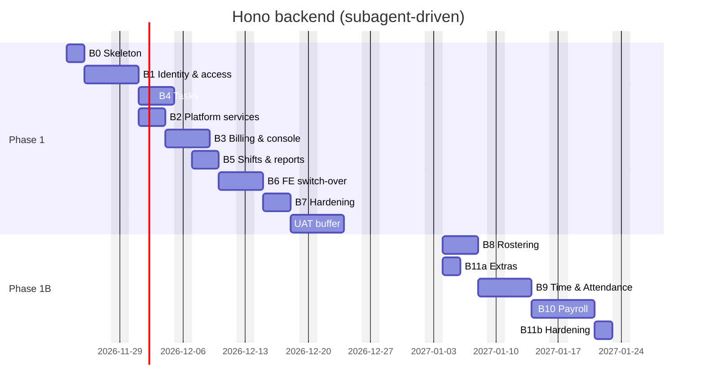

# Hono Backend Roadmap: Implementation Plan

> **For agentic workers:** REQUIRED SUB-SKILL: Use superpowers:subagent-driven-development (recommended) or superpowers:executing-plans to implement this plan task-by-task. Steps use checkbox (`- [ ]`) syntax for tracking.
>
> **Scope note:** this is the master roadmap for the backend across 12 phases (B0–B11). The spec covers many independent subsystems, so each phase gets its own detailed TDD plan (`docs/.../plans/<date>-backend-<phase>.md`, with test names, assertions and exact signatures) written **just before** that phase starts. This file locks in the architecture, the boundaries, the interfaces between phases, and the timeline.

**Goal:** Replace the JSON/in-memory mock layer (`lib/data.ts`, `features/*/store.ts`) with a real multi-tenant Hono + PostgreSQL API, so Phase 1 (M0 + M1) can go live for the first client and Phase 1B (M1A → M1B → M1C) can follow.

**Architecture:** A modular monolith in a new `api/` package (npm workspace) running Hono on Node. Each SRS module is a folder `api/src/modules/<module>/` with its own routes, service, repo, Zod schemas and events. Modules talk to each other only through `index.ts` exports and the domain-event bus (FR-M0-16). Tenant isolation is enforced twice: a `tenant_id` on every table, and Postgres Row-Level Security set per request (`SET LOCAL app.tenant_id`). The Next.js app calls the API through a typed Hono RPC client (`hc<AppType>`), swapped in behind each `features/<feature>/api.ts`, so components do not change.

**Tech Stack:** Hono 4 + `@hono/node-server`, `@hono/zod-openapi` (Zod 4, versioned REST + OpenAPI, FR-M0-17), Drizzle ORM + drizzle-kit migrations, PostgreSQL 16 (EU region), Better Auth (email/password, Google, Microsoft, TOTP, organization plugin), Redis + BullMQ (jobs, schedules, outbox relay), S3-compatible storage (R2 or MinIO) + ClamAV, Stripe behind the existing `BillingProvider` interface, pino + OpenTelemetry + Sentry, Vitest + Testcontainers (Postgres, Redis), Docker on Dokploy.

**Spec:** `.claude/docs/requirements/SRS.md` (v1.3, main), with `SRS-v1.2-built.md` for old IDs, `.claude/docs/architecture.md`, and `.claude/docs/superpowers/specs/2026-11-09-module-1a-rostering-design.md` (decisions D1–D13).

## Global Constraints

- One PostgreSQL database, tenant isolation; modules own their own tables and talk through internal APIs and domain events (SRS §2.1).
- Start as a modular monolith; split services only when load or team size demands it (§2.4).
- Hosting in an EU region (Ireland or Frankfurt) by default (§2.3, NFR-02).
- No query, file, search result or AI answer may return another tenant's data (FR-M0-02). Cross-tenant id → **404 "not found"**, never 403 (AC-M0-01).
- A module not in the tenant's plan is hidden in the UI and refused by the API with **403**, within one minute of removal (FR-M0-15, AC-M0-05).
- Immutable, tamper-evident audit entry for sign-ins, permission changes, policy changes, data exports, deletions, admin actions; kept ≥ 12 months, exportable (FR-M0-13, NFR-05).
- Device policy evaluated on **every** request to a restricted feature, not only at sign-in (FR-M0-10).
- Never hard-code tenant values: company, departments, deadline, timezone (default `Europe/Dublin`), currency (default `EUR`), branding (CLAUDE.md, FR-M0-20).
- Billing goes through Stripe now, behind a provider-agnostic billing module (FR-M0-14; existing `features/billing/providers/types.ts`).
- TLS ≥ 1.2, AES-256 at rest, secrets in a managed key store; OAuth tokens encrypted per tenant (NFR-03, FR-M0-18).
- Session idle timeout configurable, default **12 hours** on web (NFR-04).
- p95 < **500 ms** for common API calls up to 250 users/tenant; shift report submit < **2 s** on 4G (NFR-08).
- RPO 1 h, RTO 4 h, daily backups + PITR (NFR-07).
- SAST + dependency scanning in CI; tenant-isolation tests block release (NFR-13, NFR-15).
- Payroll statutory calculations stay with a certified provider (A.8 decision 1).
- Never remove Orders & Stock, client files, or the rosters incident/cover model (product owner, 28 Oct 2026).

## Review Focus

1. **Cross-tenant id guessing** — a user of tenant A passes a tenant B id to any route, including nested ones (`/tasks/:id/evidence/:evidenceId`). Expected: 404. Test: generated isolation suite in B11 that walks every route in the OpenAPI document (owned by B1, extended by every phase).
2. **Midnight-crossing shifts and DST** — a shift 22:00–06:00 on the last Sunday of October in `Europe/Dublin`. Expected: the report deadline, roster day and timesheet hours are all correct in tenant local time. Test: in B5 (`shift deadline across DST`) and B9 (`timesheet hours across DST`).
3. **Device switch mid-session** — a session started on a trusted PC then reused from an Android browser. Expected: Drive links stripped from the very next response. Test: in B1 (`drive policy re-evaluated per request`).
4. **Plan downgrade with live data** — a tenant drops M1A while rosters exist. Expected: routes return 403, data is kept, re-enabling restores it without migration (§2 "no data migration when a customer adds a module"). Test: in B3 (`entitlement removal keeps data`).
5. **Duplicate webhook / job delivery** — Stripe sends the same event twice; BullMQ retries a "report missing" alert. Expected: one state change, one notification. Test: idempotency keys in B3 (`stripe webhook idempotent`) and B2 (`outbox delivers once`).

---

## Current state (analysis, 16 Nov 2026)

| Area | What exists | What the backend must take over |
| --- | --- | --- |
| Data layer | `lib/data.ts#getData(file)` reads 88 JSON files under `public/data/<feature>/` | Every `features/<feature>/api.ts` (20 files) switches to the RPC client |
| State | In-memory `features/*/store.ts` and `lib/store.ts` | Postgres + Redis |
| Business rules | Pure, tested functions in `lib/*.ts` (permissions, devices, entitlements, roster-rules, roster-repeat, shift-report, report-deadline, task-evidence, task-scope, today, workforce, mfa, notify …) and `features/<f>/*.ts` (lifecycle, recurrence, planning, publishing, exchange …) | **Port, don't rewrite**: move pure logic to a shared `packages/domain` both sides import, keep their existing Vitest tests green |
| Auth | Cookie `od-auth` mock in `proxy.ts`, `app/actions/session.ts` | Better Auth sessions; `proxy.ts` checks the real session cookie |
| Billing | `features/billing/providers/{types,stripe}.ts` | Server-side `BillingProvider` impl + Stripe webhooks |
| Built modules (FE mock) | M0, M1 (tasks, shifts, daily reports, evidence, Today, devices), M1A rostering, platform console, audit, search, orders, files, recruitment, payroll issues, staff-rosters | All need endpoints |
| Not built at all | M1B Time & Attendance, M1C pay runs/payslips | Backend + FE both needed (FE out of scope here, flagged) |

## File structure

```
package.json                    # add "workspaces": ["api", "packages/*"]
packages/domain/                # pure rules moved from lib/*.ts (no I/O); imported by web and api
packages/contracts/             # Zod schemas + inferred types shared by web and api
api/
  src/
    app.ts                      # builds Hono app, mounts modules, exports `type AppType`
    server.ts                   # @hono/node-server entry
    worker.ts                   # BullMQ workers entry (same image, different command)
    env.ts                      # Zod-validated env
    db/
      client.ts                 # Drizzle + pg pool
      tenant-tx.ts              # withTenant(tenantId, fn) → SET LOCAL app.tenant_id
      schema/<module>.ts        # one file per module
      migrations/
    core/
      context.ts                # AppEnv: Variables { user, tenant, session, device, perms, tx }
      errors.ts                 # AppError, NotFound, Forbidden, Conflict → problem+json
      middleware/{request-id,auth,tenant,entitlement,permission,device-policy,rate-limit,audit}.ts
      events/{bus.ts,outbox.ts,types.ts}
      jobs/{queue.ts,schedules.ts}
    modules/
      auth/ tenants/ users/ teams/ rbac/ devices/ audit/ notifications/ files/
      search/ gdpr/ integrations/ billing/ platform/ settings/
      tasks/ projects/ evidence/ shifts/ shift-reports/ today/ dashboard/ attention/
      rosters/ attendance/ payroll/
      orders/ client-files/ recruitment/ staff-rosters/ assistant/
        each: routes.ts  service.ts  repo.ts  schema.ts  events.ts  index.ts  *.test.ts
  test/
    harness.ts                  # Testcontainers PG+Redis, migrate, seed, app.request helper
    factories.ts                # makeTenant(), makeUser(role), loginAs()
    isolation.test.ts           # AC-M0-01 route walker
  Dockerfile
docker-compose.dev.yml          # postgres, redis, minio, clamav, mailpit
```

Web side changes: `lib/api-client.ts` (new, `hc<AppType>` with cookie forwarding), each `features/<f>/api.ts`, `proxy.ts`, `app/actions/*`.

## Cross-phase interfaces (locked here)

```ts
// api/src/core/context.ts
type AppEnv = { Variables: {
  requestId: string
  session: { id: string; userId: string; deviceId: string | null; mfaPassed: boolean }
  user: { id: string; email: string; isPlatformStaff: boolean }
  tenant: { id: string; timezone: string; currency: string; locale: string }
  perms: PermissionSet          // from packages/domain/permissions
  device: DeviceContext | null  // from packages/domain/devices
  tx: TenantTx                  // Drizzle tx bound to tenant via RLS
}}

// api/src/db/tenant-tx.ts
withTenant<T>(tenantId: string, fn: (tx: TenantTx) => Promise<T>): Promise<T>

// middleware factories
requireModule(code: ModuleCode)                       // 403 when not entitled (FR-M0-15)
requirePermission(perm: PermissionKey)                // 403
requireFeatureOnDevice(feature: "drive" | string)     // strips or 403 per policy (FR-M0-10)

// api/src/core/events
publish(tx: TenantTx, event: DomainEvent): Promise<void>   // writes outbox row in the same tx
subscribe<E extends DomainEvent["type"]>(type: E, handler: (e) => Promise<void>): void
type DomainEvent =
  | { type: "task.completed"; taskId: string; ... }
  | { type: "shift.report.submitted"; reportId: string; ... }
  | { type: "roster.published"; ... } | { type: "clock.event"; ... } | ...

// api/src/modules/audit
recordAudit(tx, { action, entity, entityId, before, after, actorId }): Promise<void>  // hash-chained

// api/src/modules/billing
interface BillingProvider {  // mirrors features/billing/providers/types.ts
  createCustomer(...); createCheckout(...); changePlan(...); cancel(...);
  parseWebhook(rawBody: string, signature: string): BillingEvent
}

// web: lib/api-client.ts
export const api = hc<AppType>(env.API_URL, { headers: forwardCookies })
```

Routes live under `/v1/...`; platform console under `/v1/platform/...` (platform staff only, tenant data only through a logged support grant).

---

## Phases

Each phase lists its tasks (one subagent task each, with a reviewer gate). Day estimates assume subagent-driven execution supervised by one developer (see Timeline).

### B0: Workspace and API skeleton — 2 days
- [ ] **T0.1** npm workspaces (`api`, `packages/domain`, `packages/contracts`); `docker-compose.dev.yml` (postgres 16, redis 7, minio, clamav, mailpit); `api/src/env.ts`. Test: `env rejects missing DATABASE_URL`.
- [ ] **T0.2** Hono app + node server, request-id, pino logging, problem+json errors, `/healthz` `/readyz`, OpenAPI doc at `/v1/openapi.json`. Test: `unknown route returns problem+json 404`.
- [ ] **T0.3** Drizzle client, migrations, `withTenant` + RLS policy template, test harness with Testcontainers. Test: `RLS hides rows of other tenant even without WHERE`.
- [ ] **T0.4** Move pure logic from `lib/*.ts` to `packages/domain` with re-exports in `lib/` so the web app keeps working. Verify: `npm test` and `npm run typecheck` green in both packages.
- [ ] **T0.5** CI: typecheck, lint, Vitest (web + api), SAST (Semgrep/CodeQL), `npm audit`, Docker build.

### B1: Identity, tenancy, access (M0 core) — 4 days
- [ ] **T1.1** Better Auth: email/password, Google, Microsoft, TOTP; sessions in PG; idle timeout from tenant setting (default 12 h). FR-M0-03, NFR-04.
- [ ] **T1.2** Sign-up → tenant creation (organisation defaults from `auth/onboarding-defaults.json` become seeds, not code), invites by email, accept invite. FR-M0-01.
- [ ] **T1.3** Forced MFA per tenant / per role; middleware returns 401 `mfa_required` for every route. FR-M0-04, AC-M0-02.
- [ ] **T1.4** RBAC: roles (templates + clone), permissions at module/record-type/record/field level, using `packages/domain/permissions`. FR-M0-05/06.
- [ ] **T1.5** Teams, departments (= teams, A.5), reporting lines, primary manager. FR-M0-07.
- [ ] **T1.6** Device register, device policies, `requireFeatureOnDevice` evaluated per request; Drive URLs stripped from payloads. FR-M0-08/09/10, AC-M0-03.
- [ ] **T1.7** Audit module: hash-chained append-only table (no UPDATE/DELETE grants), `recordAudit`, export endpoint. FR-M0-13, AC-M0-04.

### B2: Platform services (M0 rest) — 3 days *(parallel stream with B3/B4)*
- [ ] **T2.1** Event bus: outbox table, BullMQ relay, idempotent subscribers. FR-M0-16.
- [ ] **T2.2** Notifications: in-app feed, email (Resend/SES), push (FCM, ready for Android), per-user prefs + quiet hours, delivery log. FR-M0-11.
- [ ] **T2.3** Files: tenant-scoped S3 keys, presigned upload, ClamAV scan job, short-lived signed download. FR-M0-12.
- [ ] **T2.4** Settings, branding, public holidays, integrations framework with encrypted OAuth tokens (Google Workspace first). FR-M0-18/20.
- [ ] **T2.5** Global search (Postgres FTS, permission-scoped, archived tasks excluded per `task-scope`). FR-M0-21.
- [ ] **T2.6** GDPR data-subject requests: export, correct, delete one person, as jobs. FR-M0-19.

### B3: Billing and platform console — 3 days *(parallel stream)*
- [ ] **T3.1** Plans, entitlements, seats, trials; `requireModule` with a ≤ 60 s cache. FR-M0-14/15, AC-M0-05.
- [ ] **T3.2** `BillingProvider` + Stripe impl, checkout, customer portal, idempotent webhooks, invoices, dunning, self-service cancel. NFR-18.
- [ ] **T3.3** Platform console API: tenants list/360, MRR/ARR/NRR/churn metrics, plans, staff roles, support access grants (logged), data requests, platform audit.
- [ ] **T3.4** Public API keys with scopes + outgoing webhooks (FR-M0-17, Should — can slip to B11).

### B4: M1 Tasks — 4 days
- [ ] **T4.1** Tasks CRUD, assignees, labels, checklists, subtasks, comments, history with old/new values. FR-M1-01..05, 10..14.
- [ ] **T4.2** Projects, milestones, finish-to-start dependencies with knock-on preview (`planning.ts`).
- [ ] **T4.3** Recurrence + templates (`recurrence.ts`, `templates.ts`) as scheduled jobs.
- [ ] **T4.4** Archive (30 days), admin purge (audited), board/calendar queries.
- [ ] **T4.5** Evidence rules, evidence items (via Files), reviews (auto/creator/manager/named), verify/reject. FR-M1-40..49.
- [ ] **T4.6** Voice notes on tasks (≤ 2 min, file upload).

### B5: M1 Shifts, reports, home — 3 days
- [ ] **T5.1** Shift patterns, assignments, reporting on/off per member with team default. FR-M1-20..22.
- [ ] **T5.2** Shift reports: rows from the member's shift tasks, submit updates tasks, versions, accept/return with comment. FR-M1-23..31.
- [ ] **T5.3** Deadline job: "missing at deadline" alerts member + manager (tenant deadline, default 1 h, Q7). DST test from Review Focus #2.
- [ ] **T5.4** Report exports (PDF/Excel/CSV) as jobs to Files.
- [ ] **T5.5** Read models: dashboard, attention, Today, staff dashboard (aggregate queries, cached per tenant).

### B6: Front-end switch-over, Phase 1 — 3 days
- [ ] **T6.1** `lib/api-client.ts`; real session in `proxy.ts`; sign-in/up/MFA pages call Better Auth.
- [ ] **T6.2** Switch `features/*/api.ts` for M0 + M1 + billing + platform + audit + search; server actions call the API; delete matching in-memory stores.
- [ ] **T6.3** Seed script: `public/data/**/*.json` → demo tenant in Postgres (keeps the live demo working).
- [ ] **T6.4** Playwright e2e for CR-01..CR-06 happy paths. Verify: `npm run smoke` + e2e green.

### B7: Phase 1 hardening and go-live — 3 days
- [ ] **T7.1** Isolation suite walks every OpenAPI route with tenant-B ids (AC-M0-01), blocks CI.
- [ ] **T7.2** Load test (k6) at 250 users: p95 < 500 ms; indexes from `EXPLAIN`.
- [ ] **T7.3** Observability: OTel traces, Sentry per tenant, alerts; backups + PITR + restore drill.
- [ ] **T7.4** Staging + production on Dokploy (EU), secrets in key store, security review checklist ready for the external pen test (NFR-13).

**Gate:** client signs off CR-01..CR-06, security review passed → Phase 1 live.

### B8: M1A Rostering — 4 days
- [ ] Locations, zones, shift templates, staffing targets, rosters/weeks, assignments with individual start/end, open shifts, swaps, availability, leave (owner per A.8 #3), location access grants (supervisor scope), qualifications, rule violations, repeat rules, change requests, publish/lock. Port `lib/roster-*.ts`, `features/rosters/*.ts`. Switch `features/rosters/api.ts`, `staff-rosters/api.ts`.

### B9: M1B Time & Attendance — 4 days backend (+ FE not yet built)
- [ ] Clock in/out + breaks with zone check, kiosk mode, exceptions (no-show, late), correction requests, timesheets + lines, hour types, approval by location supervisor, compliance results. Emits `clock.event`, consumes `roster.published`.
- ⚠ Needs Q14 answered; front-end screens for M1B are not built (separate FE plan, ~4–5 days).

### B10: M1C Payroll — 5 days backend (+ FE not yet built)
- [ ] Pay profiles, pay rules, pay calendar, pay runs from approved timesheets, allowances/deductions, leave accrual, payslips (PDF), payment file, journal, pay queries (link existing `payroll/issues`), `ProviderConnection` adapter + reconciliation (A.8 #2, FR-PY-34).
- ⚠ Blocked on provider choice (Q11/Q15) and pay rules (Q16). Build against an adapter interface with a fake provider first.

### B11: Kept extras + Phase 1B hardening — 3 days *(extras can run parallel from B8)*
- [ ] Orders & Stock, client files / employee docs, recruitment, staff-rosters incidents/cover, assistant (stub, rules-based Today stays; AI is Phase 2).
- [ ] Isolation suite + load test re-run with M1A–M1C routes; first pay run reconciliation drill.

**Gate:** client signs off CR-07..CR-11, first pay run reconciled.

---

## Timeline (subagent-driven)

Assumptions: start **Mon 23 Nov 2026**; one developer supervising full-time (reviews each task, answers questions, merges); 2 parallel streams in git worktrees where phases are independent; Irish holidays 25–26 Dec and 1 Jan, plus a break 24 Dec–1 Jan.

| Phase | Work days | Dates | Stream |
| --- | --- | --- | --- |
| B0 Skeleton | 2 | 23–24 Nov | A |
| B1 Identity & access | 4 | 25–30 Nov | A |
| B4 Tasks | 4 | 1–4 Dec | A |
| B2 Platform services | 3 | 1–3 Dec | B |
| B3 Billing & console | 3 | 4–8 Dec | B |
| B5 Shifts & reports | 3 | 7–9 Dec | A |
| B6 FE switch-over | 3 | 10–14 Dec | A |
| B7 Hardening, staging | 3 | 15–17 Dec | A+B |
| Buffer / client UAT | 4 | 18–23 Dec | — |
| *Break* | — | 24 Dec–1 Jan | — |
| B8 Rostering | 4 | 4–7 Jan | A |
| B11a Extras | 2 | 4–5 Jan | B |
| B9 Time & Attendance (+FE) | 4 (+4 FE) | 8–13 Jan | A (FE on B) |
| B10 Payroll (+FE) | 5 (+5 FE) | 14–20 Jan | A (FE on B) |
| B11b Hardening 1B | 2 | 21–22 Jan | A+B |
| Buffer | 3 | 25–27 Jan | — |



**Totals**
- Phase 1 backend live-ready: **~20 work days** (≈ 4 weeks), go-live target **18–23 Dec 2026**.
- Phase 1B: **~17 work days** backend + ~9 days M1B/M1C front end on the parallel stream, target **late Jan 2027**.
- Whole roadmap: **~37 work days ≈ 8 weeks of calendar time (9–10 with the holiday break)**.
- Same work by one developer without agents: roughly **4–5 months**. Agents compress the coding; the floor is set by review, decisions and outside dependencies.

**What can stretch the dates (not agent speed):**
1. Open questions Q11, Q14, Q15, Q16 (payroll provider, clock-in device, pay rules) — B9/B10 stall without them.
2. Google OAuth app verification for Drive scopes (can take 1–3 weeks) — start in B1.
3. Stripe live account + EU VAT setup; external pen test booking (NFR-13) — book during B4.
4. Android app (push, offline drafts, CR-06) is **not** in this plan; it needs its own plan.
5. Supervising developer's review time: at 1 reviewer, ~6–10 merged tasks/day is the realistic ceiling.
